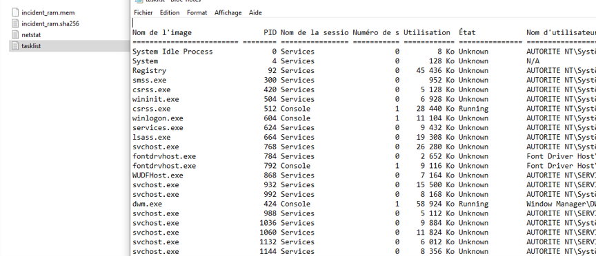
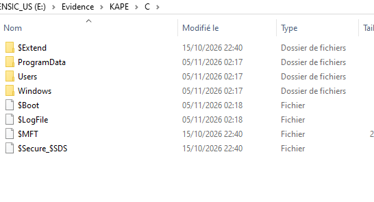
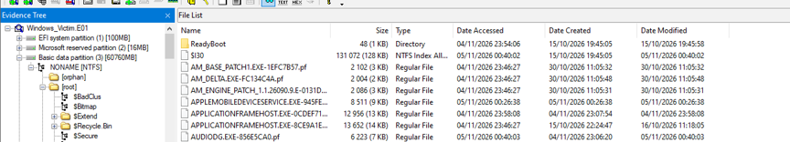
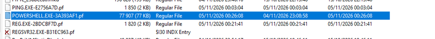
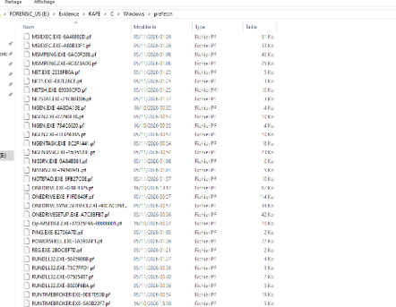
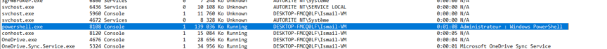
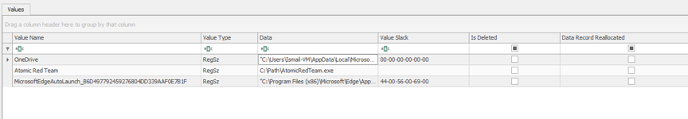
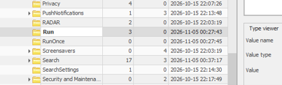

# DFIR Lab – Windows Evidence Acquisition & Analysis (Atomic Red Team)

**Lab by Ismail Bajjou**

Digital forensics lab: acquire and analyze evidence from a Windows 10 VM
where two MITRE ATT&CK techniques were simulated with Atomic Red Team.

> Full report (French): [report/Rapport_TP_Acquisition.pdf](report/Rapport_TP_Acquisition.pdf)

## Scenario
An unusual activity was reported on a Windows workstation.
Question to answer: **what happened, and which evidence proves it?**

## Simulated techniques
| Technique | Description | Atomic test |
|---|---|---|
| T1059.001 | Command and Scripting Interpreter: PowerShell | `Invoke-AtomicTest T1059.001 -TestNumbers 17` |
| T1547.001 | Registry Run Keys / Startup Folder (persistence) | `Invoke-AtomicTest T1547.001 -TestNumbers 1` |

## Tools
FTK Imager · KAPE (gkape) · Registry Explorer · Atomic Red Team · PowerShell

## Methodology
1. **Acquisition in order of volatility (RFC 3227):** RAM → process list → disk → KAPE triage
2. **Integrity:** SHA-256 for the memory dump; MD5 + SHA-1 verification for the E01 image
3. **Analysis:** E01 image (Prefetch, user profile, NTUSER.DAT export), live process state, registry
4. **Correlation** of disk, memory/process and registry artifacts, plus chain of custody

## 1. Acquisition

### Memory dump and hash
`incident_ram.mem` (about 5 GB, 4 GB RAM + pagefile) captured with FTK Imager, then hashed with SHA-256.

### Process list (volatile state)
`tasklist /v` saved right after the RAM capture.

### KAPE triage
Targeted collection of the `C:` volume to the USB drive (never to the victim disk).

## 2. Disk image analysis

### E01 image loaded in FTK Imager
`Windows_Victim.E01` (3 partitions, NTFS volume), verified twice by FTK Imager (MD5 and SHA-1 all "verified").

### Prefetch trace of PowerShell
`POWERSHELL.EXE-3A393AF1.pf` in `C:\Windows\Prefetch` (last run 2026-11-05 00:26:08 UTC).

The same file is present in the KAPE collection (times shown in local time, UTC+1).

## 3. Live state and registry

### PowerShell in the live process list
`powershell.exe` (PID 8108) running in an elevated console.

### Persistence in the Run key
Value `Atomic Red Team` → `C:\Path\AtomicRedTeam.exe` in the user's `Run` key (MITRE T1547.001).

The `Run` key was last written on 2026-11-05 00:27:43 UTC.

## Evidence integrity
| Evidence | Hash |
|---|---|
| `incident_ram.mem` (SHA-256) | `ED1B66567A2A55FCE3EC7F40445AE975D5988DF4BC55C2E5F03E3CE7965BDB25` |
| `Windows_Victim.E01` (MD5) | `38e14dbb3c13a225ef76d25f771205a3` |
| `Windows_Victim.E01` (SHA-1) | `26218a3667dd30914df15d4c6782fb99b5ccc095` |

## Key findings
- **PowerShell was executed:** Prefetch file in the disk image and `powershell.exe` (PID 8108, elevated console) in the live process list.
- **Persistence was created:** value `Atomic Red Team` in `HKCU\Software\Microsoft\Windows\CurrentVersion\Run`.
- **Evidence integrity verified:** E01 verified twice by FTK Imager; RAM hash recorded.

## Limitations
- Live acquisition leaves a small footprint on the system.
- Prefetch files were not parsed (no command line / run history); PECmd would be needed.
- Memory dump not analyzed yet; Volatility is the next step.
- The Run key timestamp dates the last change of the whole key, not necessarily the creation of the value.

## Next steps
Memory analysis with Volatility 3, Prefetch parsing with PECmd, PowerShell event logs (4104).

## Notes
Lab performed in an isolated VM. No real malware was used. Raw evidence files are not included.

---
**Author:** Ismail Bajjou
